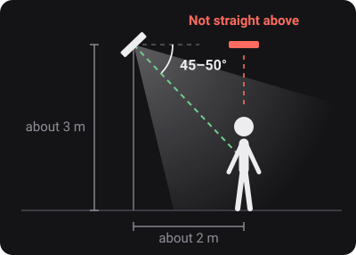
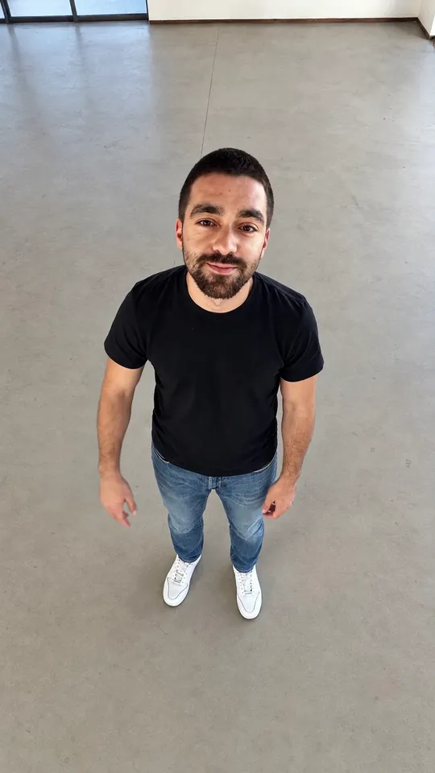
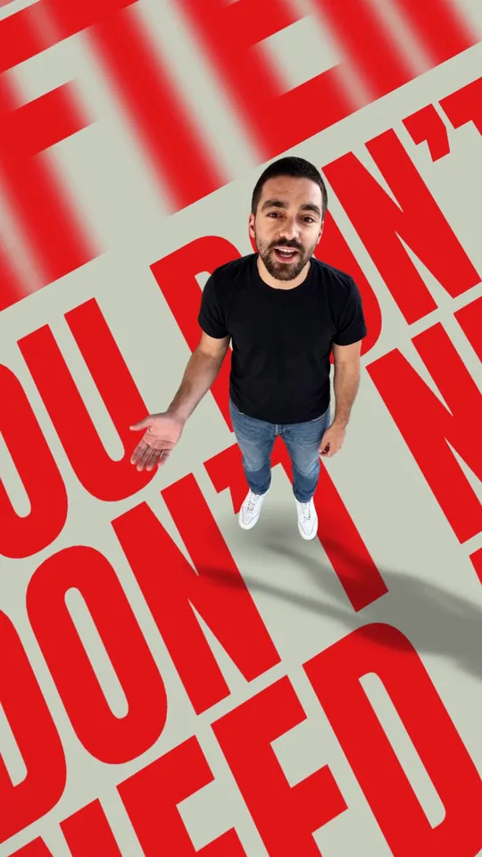
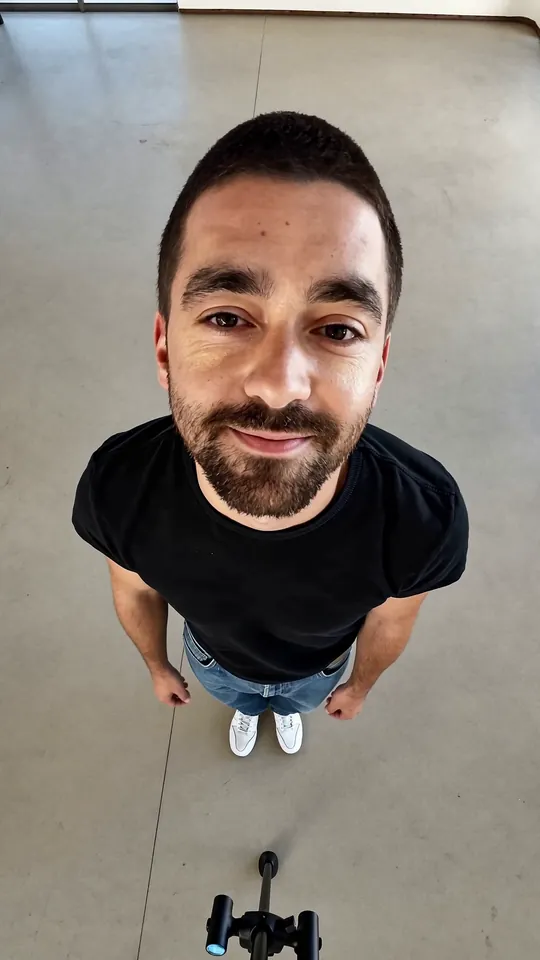
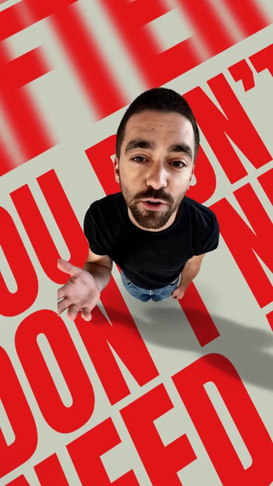
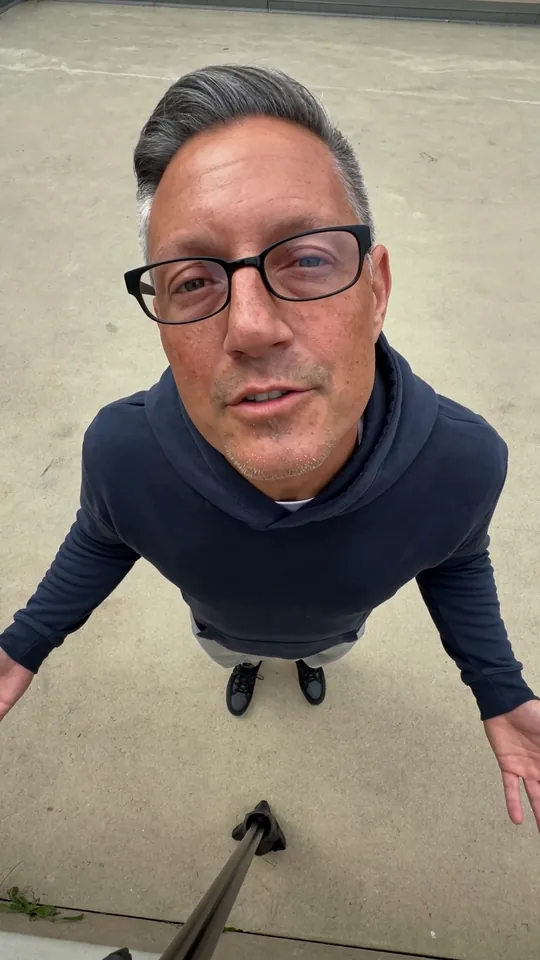
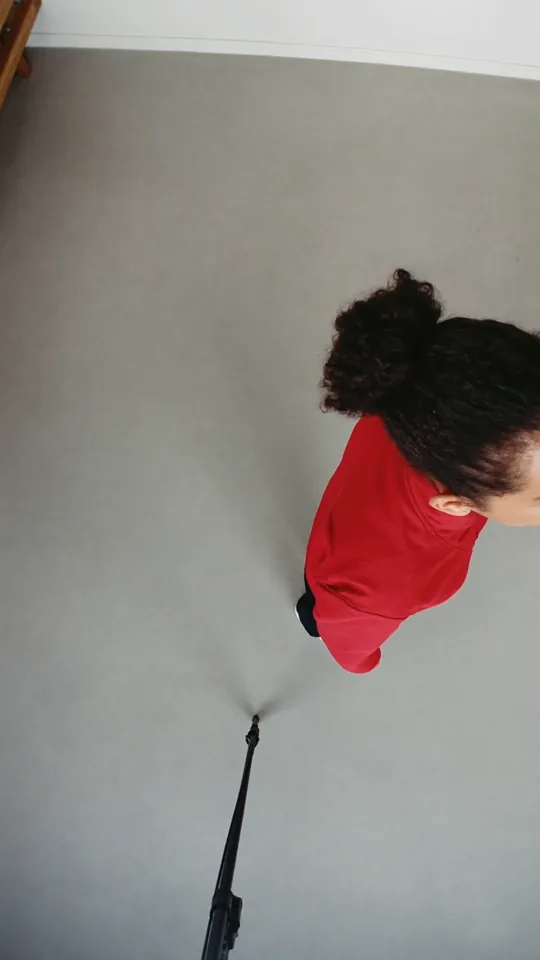
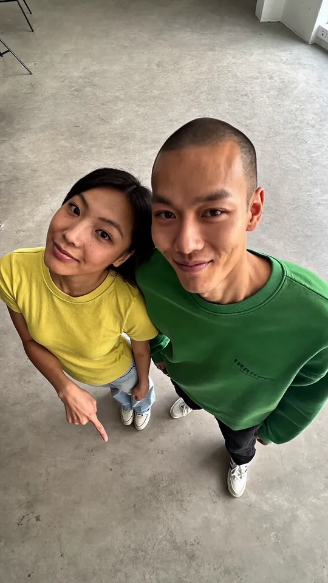

# floored.

*your words, on the floor, in 3D.*

floored is a free Claude Code plugin. You film a short top-down clip of yourself, and it makes an intro where you stand
on a floor of big 3D words. It cuts you out of the video, lays the words on the floor around you, and renders an MP4
on your computer.


## Requirements

- **Claude Code** (the desktop app or the CLI).
- **Windows 11** or **macOS 13 or newer** (Apple silicon or Intel). It is tested by hand on Windows 11. The setup
  from nothing (no Python, no Node.js, no ffmpeg; on a Mac no developer tools and no Homebrew either) is checked by
  automated tests on GitHub's Windows and Mac machines at every release, with real cutouts and exports. Nobody has
  tried it on a real Mac yet, so please report anything that looks off there.
- A computer with no special graphics card. It runs on the processor by default. The graphics card is used only if
  the setup's quality check shows the result is identical.
- **Nothing to install by hand.** floored uses the Python (3.10 or newer), Node.js (22 or newer) and ffmpeg on your
  computer when they are there. When one is missing, setup downloads floored's own copy into floored's own folder:
  no installer, no password, and nothing else on your computer changes. The studio opens in the Claude desktop app's
  browser pane, or in Chrome or Edge (any Chromium browser works).
- About 1.5 GB of free disk space for the one-time setup on a computer that starts with nothing (about 1 GB when
  Python, Node.js and ffmpeg are already there). Setup tells you the sizes before it downloads anything.
- A clip: 9:16, one person, still camera, 3 to 8 seconds (up to 10 works with a warning).

The Python packages the studio needs are pinned in `plugin/skills/floored/app/requirements.txt` (and
`requirements-words.txt` for the optional speech reader).

## Install

**In the Claude desktop app** (no terminal needed), open a Code session in any folder and send this message:

> Install the floored plugin for me. Run `claude plugin marketplace add aipauloshimas/floored`, then
> `claude plugin install floored@floored`. If the `claude` command is not found, run them with the Claude Code
> program this session itself runs on (the `claude` process that started your shell).

Claude asks before it runs each command. When both are done, start a new session: floored is there.

**In a terminal** (the Claude Code CLI):

```
claude plugin marketplace add aipauloshimas/floored
claude plugin install floored@floored
```

Then start a new Claude Code session.

## Update

floored doesn't update by itself. To get the latest fixes, run these in a terminal:

```
claude plugin marketplace update floored
claude plugin update floored@floored
```

Then start a new Claude Code session. In the desktop app, ask Claude instead: "Update the floored plugin for me",
and it runs the same two commands.

## First run

Ask Claude for a floor text intro: "make me a floor text intro", or drop your clip into the chat and say so. The first
time, Claude checks your setup and asks before it installs or downloads anything, with the size of each item (the
cutout model is about 15 MB, the video renderer is the big one). After that it starts the studio in your browser, sends your clip in, and waits
while it is processed. The studio shows the time left.

Then you pick a look, edit the words if you like (Claude suggests a few hooks), and press **Export** yourself. Claude
never presses it for you.

The floor fonts draw Latin letters, with the accents of Western and Central European languages. Words in other
alphabets (Cyrillic, Greek, Arabic, Hindi, Japanese, Korean) and words with Vietnamese accents are left off the floor
for now.

No clip yet? The studio's home page has a sample take, so you can try the looks first (it ships in
`plugin/skills/floored/app/sample/`).

## Filming guide

Short version: phone up high and a little in front, tilted down (not straight down), whole body in the frame, one spot,
3 to 8 seconds. The full guide, with the details, is in
[`plugin/skills/floored/reference/filming.md`](plugin/skills/floored/reference/filming.md).

<p align="center"></p>

<table>
<tr><th align="left">Film it like this</th><th align="left">Not from straight above</th></tr>
<tr><td valign="top"> <br><b>Your whole body stands on the words.</b><br>Legs and shoes in the shot, room on every side.</td><td valign="top"> <br><b>Your legs and feet go missing.</b><br>From straight above they hide under your body. Film from further back.</td></tr>
</table>

<table>
<tr><th align="left">Too close</th><th align="left">Walking</th><th align="left">Two people</th></tr>
<tr><td valign="top"><br>Part of you leaves the frame, and it ends in a straight cut. Leave room on every side.</td><td valign="top"><br>Your feet move, so the words don't stay lined up with you. Stand on one spot.</td><td valign="top"><br>floored works best with just you.</td></tr>
</table>

## Privacy

Everything runs on your computer. Your video never leaves it, and Claude never uploads it. The only downloads are the
tools and models at setup; after that, floored works offline.

## Uninstall

In a terminal (or ask Claude to run them, as in Install):

```
claude plugin uninstall floored
claude plugin marketplace remove floored
```

That removes the plugin. Setup also puts files in a few folders of your home directory, and they stay until you delete
them:

| Folder | What it holds | Size |
|---|---|---|
| `~/.floored` | the private Python environment, the video renderer, your preferences, floored's own Python, Node.js and ffmpeg when setup downloaded them (in `tools/`), and, on Windows with a long user path, the renderer's browser cache `hf-cache` | the bulk of the setup |
| `~/.cache/hyperframes` | the headless Chrome the renderer downloaded (it is not bundled) | about 282 MB |
| `~/.hyperframes` | the renderer's small config and install-state files | small |
| `~/.cache/rvm` | the cutout model | about 15 MB. Other tools may share these weights, so check before deleting |

Delete the ones you want gone (on Windows, `Remove-Item -Recurse -Force ~/.floored` in PowerShell; on a Mac,
`rm -rf ~/.floored`).

Your takes and exports are **not** in those folders. They live in each project, in the `floored/` folder next to your
work (`takes/`, `exports/` and `settings/` inside it). Deleting the plugin or `~/.floored` leaves them alone, and
deleting those project folders is your choice.

## Licences

floored's code and its sample take are MIT (`LICENSE`). The fonts, GSAP and the tools that setup installs have their own licences:
see `THIRD_PARTY.md` and `plugin/skills/floored/licenses/`.
